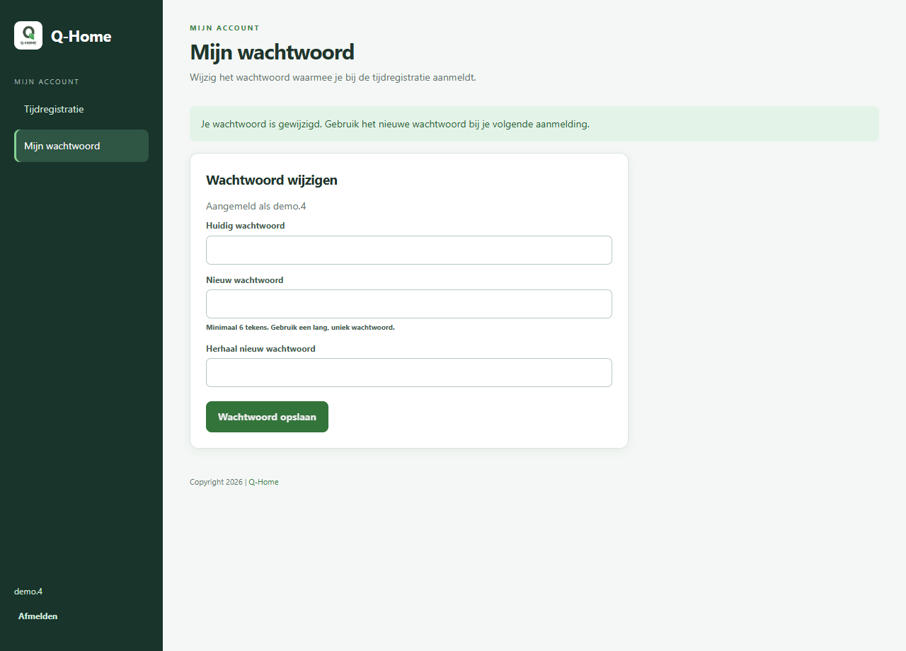

# Eigen wachtwoord en nachtelijke afsluiting — 1.2.1

## Eigen wachtwoord

Iedere aangemelde medewerker ziet **Mijn wachtwoord** in de navigatie van de HR-omgeving, ook op mobiel. Voer het huidige wachtwoord in, kies een nieuw wachtwoord, herhaal het en sla op. De velden worden na succes gewist. Het nieuwe wachtwoord geldt voor TimeTracking; het verandert geen Miniservercredentials.

De server controleert de actuele identiteit en blokkering. Een medewerker of HR-gebruiker kan geen ander account wijzigen. Voor een eigen wijziging is het huidige wachtwoord verplicht, ook via het oudere profielscherm en ook voor beheerders. Technisch beheer behoudt de bestaande mogelijkheid om het wachtwoord van een ander account opnieuw in te stellen. Een vergelijking met de eerder gelezen hash voorkomt overschrijven van een gelijktijdige wachtwoordwijziging.

De bestaande minimumlengte van zes tekens blijft gelden. Nieuwe wachtwoorden boven 72 UTF-8 bytes worden geweigerd, zodat bcrypt geen verschillende wachtwoorden ongemerkt gelijk behandelt. Spaties aan begin en einde blijven bewaard; een wachtwoord dat alleen uit spaties bestaat wordt geweigerd. Ruwe wachtwoorden worden niet gelogd.



## Wat betekende de melding nul

`Automatic STOP badges inserted: 0` betekent dat de uitvoerder gestart is en geen STOP heeft toegevoegd. De oude pakketplanning stond op **11:59 overdag**, niet 's nachts. Op een werkdag kon een START om 08:00 een berekende eindtijd om 16:00 hebben, die tijdens de middagrun nog in de toekomst lag. De losse melding nul bewijst niet dat cron uitgeschakeld was.

Zonder de daadwerkelijke croninstallatie op de Qbox te inspecteren kan de pakketcode de actieve hostplanning niet bewijzen. Deze fix corrigeert de pakketplanning; zij is niet uitgevoerd op productie en herstelt daar niet stilzwijgend historische data.

## Nieuwe planning en behoud van regels

Het pakket plant de taak eenmaal per nacht om **00:05 in de LoxBerry-hosttijdzone**, met een `flock` tegen overlap. De opdracht gebruikt `--completed-days`: gisteren en de voorgaande afgeronde dag worden bekeken volgens de ingestelde bedrijfstijdzone. De hostklok en -tijdzone moeten dus correct zijn. De standaardlookback is twee afgeronde startdagen; dit is geen onbeperkte historische hersteloperatie.

De ingestelde automatische STOP-regel blijft behouden: standaard acht **verstreken** uren na START, met pauzes dus minder dan acht netto-uren. Signaleren, voorstellen en expliciet ingestelde automatische afsluiting blijven hun eigen gedrag volgen. Er wordt geen automatische STOP gemaakt voor de huidige startdag of voor een berekende eindtijd die nog in de toekomst ligt. Een nachtdienst die om 00:05 nog geen acht verstreken uren heeft bereikt wordt overgeslagen en pas in een volgende geschikte nachtronde opnieuw beoordeeld.

De nieuwe nachtronde leest de effectieve HR-registraties. Een echte STOP op de volgende dag, een handmatige afsluiting of een door HR vervallen START voorkomt een onterechte systeemstop. Bestaande bronregistraties en automatische stops worden niet herschreven. Afgesloten/geraakte periodes blijven door de bestaande HR-controles beschermd.

De log toont begin/einde met UTC-tijdstip, bij begin ook lokale bedrijfstijd, verwerkte startdag, tijdzone en aantallen. Mogelijke tellers:

- `open_sessions`: open starts die voor de verwerkte dag in aanmerking komen.
- `future_end`: de berekende eindtijd is nog niet verstreken.
- `signalled` / `proposed`: het beleid signaleert alleen of maakt een voorstel; dan zijn nul nieuwe STOP-events normaal.
- `blocked_period`: een HR-periodecontrole blokkeerde de wijziging.
- `invalid_source`: ongeldige brontijden vragen eerst HR-onderzoek; de betreffende medewerker wordt overgeslagen.
- `already_present`: een eerdere systeemstop bestaat al.

Database- en opslagfouten worden niet meer als een gewone periodeblokkering verborgen; de taak faalt dan zichtbaar met exitcode 1 en een fouttype zonder verbindingsgeheimen. De database wordt uit de MongoDB-URI gekozen, tenzij een expliciete `MONGO_DB_NAME` is ingesteld, zodat de taak dezelfde klantdatabase als de backend gebruikt.

## Update en controle op een geïsoleerde Qbox

Installeer versie 1.2.1 eerst op een test-/herstelkopie. De bestaande lifecycle behoudt configuratie, branding en volumes en bouwt de applicatie-images opnieuw. De bestaande LoxBerry-plugininstallatie verwerkt de gewijzigde crontab. Controleer eventuele eerder handmatig aangelegde dubbele taken apart; het pakket kan die niet vanuit de container verwijderen.

Controleer op de host zonder gegevens te wijzigen:

```sh
date
grep -R -n 'auto_stop_missing_badges.py' /etc/cron.d /etc/crontab
tail -n 30 /opt/loxberry/log/plugins/timetrackingplugin/auto_stop_missing_badges.log
```

Controleer na installatie van de nieuwe image eerst met een dry-run op de herstelkopie:

```sh
docker exec backend python /app/scripts/auto_stop_missing_badges.py --completed-days --dry-run
```

Gebruik geen schrijvende herstelopdracht op productie zonder afzonderlijke beoordeling van de gevonden sessies. Het pakket verandert de toekomstplanning en haalt alleen de ingestelde lookback in wanneer de taak later normaal draait. Een herstart van alleen de container installeert geen nieuwe broncode in een oude image.

## Validatie

Synthetische regressies controleren eigen wachtwoord wijzigen en opnieuw aanmelden, fout huidig wachtwoord, accountgrenzen, beheerdersreset, concurrentie en validatie. Nachttests controleren de middagrun/nachtplanning, twee dagen terugkijken, acht verstreken uren, herhalen zonder dubbele STOP, HR-overlays, echte nachtstops, toekomstige eindtijden, signaleren/voorstellen, dry-run, periodeblokkades, foutafhandeling, tijdzone/DST en de database uit de URI. De browsercontrole gebruikt een echt lokaal medewerkerlogin tegen een in-memory database, geen productieaccounts.
