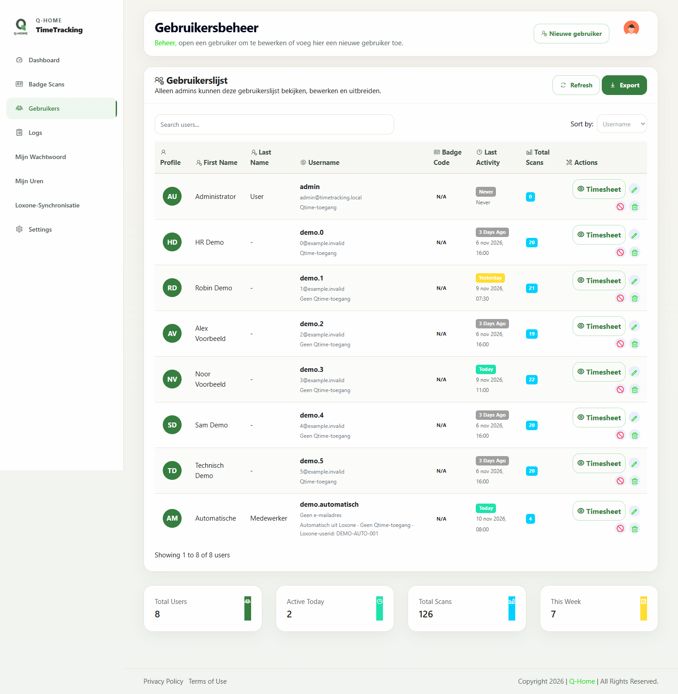
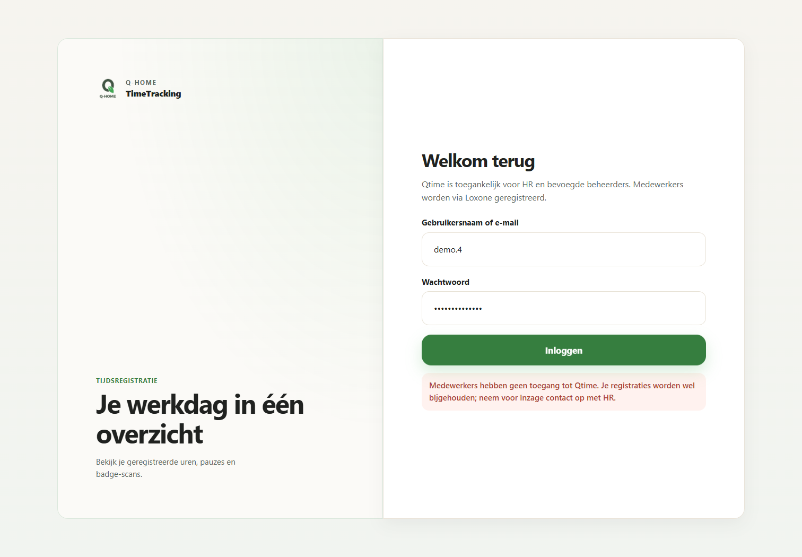

# Automatische medewerkers en toegang tot Qtime — 1.2.2

## Nieuwe werking

De eerste geldige badge-/toegangsregistratie uit Loxone maakt automatisch een echt medewerkerrecord aan. Een beheerder hoeft die persoon niet eerst handmatig in Qtime toe te voegen. De nieuwe medewerker is direct beschikbaar voor HR, roosters en urenoverzichten. Een scan is nog steeds een scan: de bestaande acties bepalen of er ook werktijd begint of eindigt.

De automatische aanmaak gebeurt uitsluitend via de bestaande backend-ingang met de private integratiesleutel. Een aanmeldpoging op de website maakt geen gebruiker aan. Een meegestuurde rol, wachtwoord of interne medewerker-ID uit een registratie verleent geen rechten.

**Medewerkers mogen niet aanmelden op Qtime.** De rol `user` dient voor registraties en HR-administratie. Dit geldt ook voor bestaande handmatig aangemaakte medewerkers met een wachtwoord. Eerder uitgegeven medewerkerstokens worden bij beveiligde API-aanvragen eveneens geweigerd. Alleen `hr`, `admin` en `technical_admin` kunnen op de website aanmelden; hun bestaande onderlinge rechten blijven behouden.

Deze toegangsafspraak vervangt de eerdere beschrijving van medewerkers die eigen uren bekijken, correcties aanvragen of hun wachtwoord wijzigen. HR voert de dagelijkse controles en correcties uit. De functie Mijn wachtwoord blijft beschikbaar voor HR en bevoegde beheerders.

## Welke gegevens worden gebruikt

- De `user_id` is de externe Loxone-identiteit. `userid` en `userId` worden eveneens herkend; tegenstrijdige waarden worden geweigerd. Zowel tekst-ID's als gehele getallen worden ondersteund. Herhaling van dezelfde userid maakt geen dubbele medewerker aan.
- De aangeleverde gebruikersnaam en voor-/achternaam worden gebruikt voor herkenning. Als alleen de userid bekend is, wordt een vaste interne gebruikersnaam gemaakt. HR kan de leesbare naam via Medewerkers aanpassen.
- Oudere lezers die uitsluitend een gebruikersnaam sturen worden ook ondersteund: een exacte naam vormt dan de voorlopige identiteit. Een later ontvangen userid kan gecontroleerd aan dezelfde medewerker worden gekoppeld. Zonder userid is een naamswijziging geen bewijs dat het dezelfde persoon is.
- Er wordt geen standaardwachtwoord ingesteld, geen activatiebericht verstuurd en geen Qtime-toegang voor medewerkers aangemaakt. Een gereserveerd intern adres onder `users.invalid` houdt de bestaande unieke e-mailindex bruikbaar; het is geen werkelijk e-mailadres. De gebruikerslijst toont daarvoor Geen e-mailadres. Een beheerder kan later een werkelijk adres vastleggen.
- Er wordt geen fictief rooster of urennorm toegevoegd. HR moet nog het juiste rooster en de ingangsdatum toewijzen.

Het medewerkerrecord heeft een stabiele interne MongoDB-ID. Nieuwe registraties krijgen die relatie mee. Een veranderde brongebruikersnaam bij dezelfde userid maakt geen tweede medewerker. Scantotalen worden waar mogelijk op de interne ID gegroepeerd, zodat ook registraties zonder gebruikersnaam zichtbaar meetellen.

## Bestaande personen en naamconflicten

Een bestaand medewerkersrecord met dezelfde externe ID wordt hergebruikt. Een uniek standaardmedewerkersrecord met exact dezelfde naam kan gecontroleerd worden gekoppeld, met behoud van wachtwoord, blokkering en rol. Een nieuwe bronidentiteit claimt geen beheeraccount alleen vanwege een gelijke naam. Een naam die al bij een andere userid hoort wordt niet samengevoegd; de nieuwe medewerker krijgt een andere interne naam.

Een gearchiveerde identiteit wordt niet automatisch opnieuw geactiveerd. Onzekere dubbele externe ID's of een koppeling die goedgekeurde/afgesloten uren kan beïnvloeden worden niet stilzwijgend samengevoegd. De bronregistratie blijft bewaard met een onopgeloste identiteit en een waarschuwing in de diagnose. HR kan de identiteit na onderzoek via de bestaande gecontroleerde koppeling oplossen.

Gelijktijdige eerste registraties worden opgevangen door een unieke, sparse provisioning-index en herhaalde controle bij een indexconflict. Bestaande gebruikers zonder de nieuwe metadata blijven geldig. De gewone profielbewerking kan de nieuwe identiteitsmetadata niet per ongeluk verwijderen of vervangen.

## Wat zie je in de interface

In Accounts & rechten staat bij automatisch aangemaakte medewerkers **Automatisch uit Loxone**, de Loxone-userid en **Geen Qtime-toegang**. HR ziet de medewerker in het urenoverzicht en kan naam, afdeling, personeelsnummer en rooster verder inrichten. Roltoewijzing blijft een expliciete handeling van technisch beheer; een registratie kan nooit automatisch HR- of beheerrechten toevoegen.

Op het aanmeldscherm staat wie mag aanmelden. Een medewerker krijgt een duidelijke toegangsweigering en ontvangt geen token. HR en beheerders kunnen normaal aanmelden. Wachtwoorden worden bij aanmelden niet langer getrimd; eventuele begin-/eindspaties blijven dus onderdeel van het echte wachtwoord. Een ontbrekende of ongeldige hash levert een gecontroleerde fout op, geen interne serverfout. De loginrespons met token wordt niet meer naar de browserconsole gelogd.

## Update en controle

Versie 1.2.2 bewaart bestaande configuratie, branding, volumes, rollen en registraties. Er draait geen script dat alle historische events herschrijft of willekeurig oude namen samenvoegt. De automatische aanmaak wordt actief bij de eerstvolgende geldige registratie van de betrokken persoon. Eerdere onopgeloste historie kan daardoor via dezelfde gecontroleerde identiteit zichtbaar worden, terwijl de bronrecords zelf bewaard blijven.

Controleer eerst op een geïsoleerde herstelkopie:

1. HR en technisch beheer kunnen aanmelden; een medewerker kan dat niet, ook niet met een oud token.
2. Een synthetische eerste Loxone-registratie voegt precies één medewerker toe met rol `user` en zonder wachtwoord.
3. Een volgende registratie met dezelfde userid houdt dezelfde interne medewerker-ID.
4. HR kan het juiste rooster toewijzen en de registratie terugvinden.
5. Controleer onbekende of dubbele identiteiten afzonderlijk; pas geen gegevens rechtstreeks in MongoDB aan.

Er is geen fysieke Miniserver of productie-Qbox gebruikt voor deze ontwikkeling. Tests en screenshots gebruiken mocks en synthetische gegevens. Controleer de daadwerkelijke MQTT-veldnamen en private integratiesleutel tijdens de testupgrade. Binnen één installatie moeten externe userids één betrouwbare identiteitsruimte vormen; samengevoegde feeds met overlappende userids vereisen eerst een expliciete bronidentiteit.
