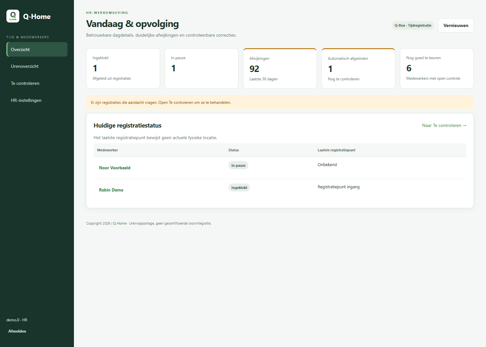
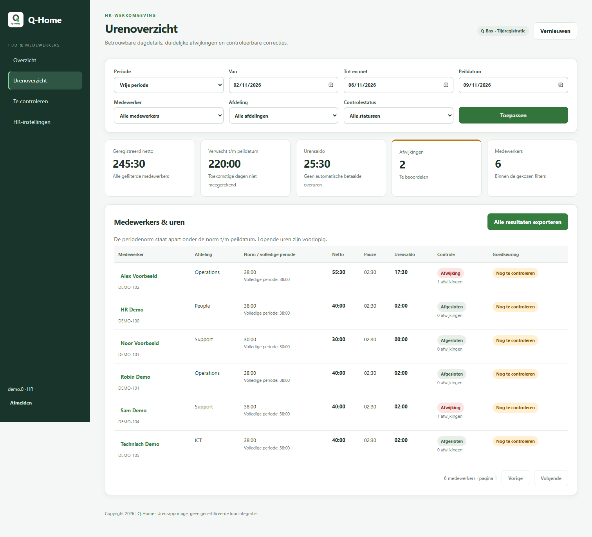
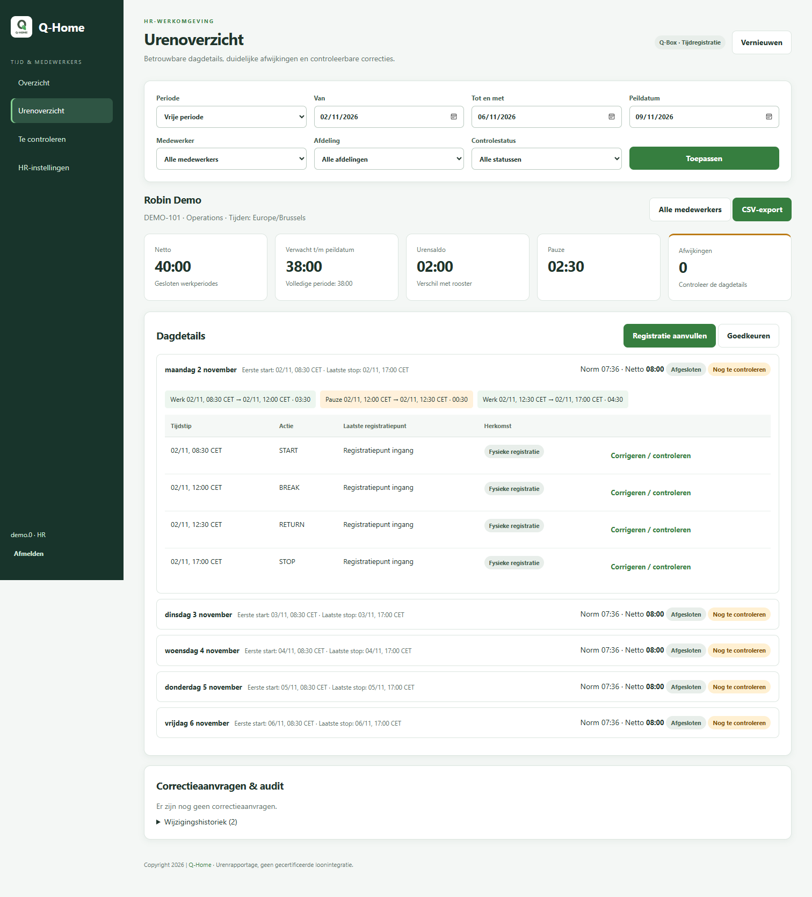
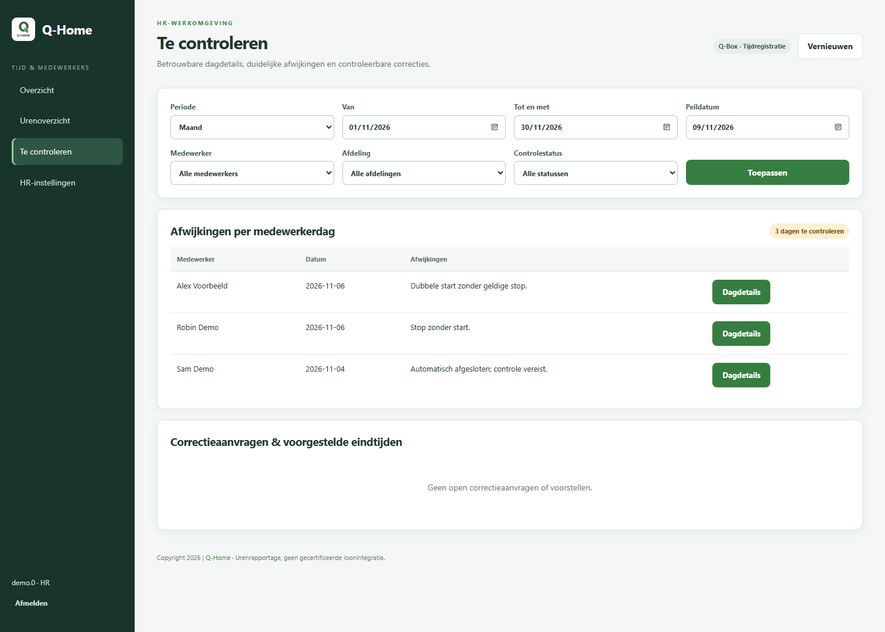
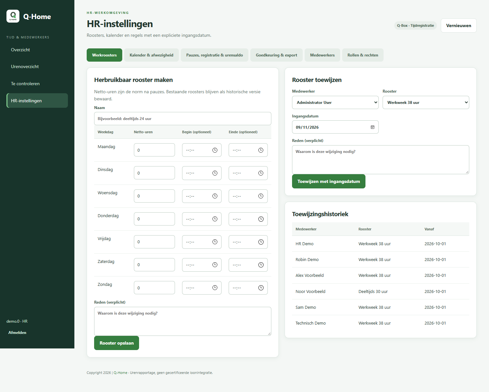
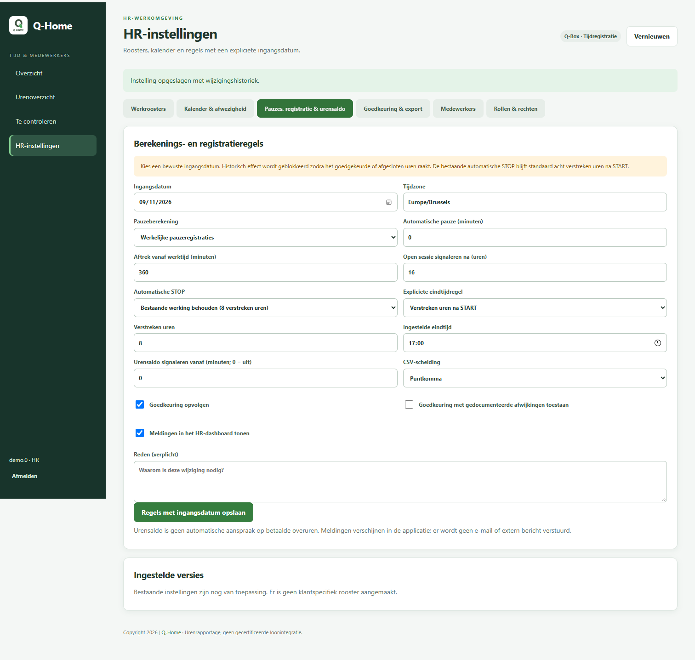

# HR-tijdregistratie — versie 1.2.3

**Nieuw in 1.2.3:** standaard acht netto-uren op maandag t/m vrijdag voor personen zonder persoonlijk rooster, en gedateerde afronding van START/STOP. Zie [afronding en standaard werkregime](ROUNDING_AND_DEFAULT_REGIME.md).

**Toegangsafspraak vanaf 1.2.2:** medewerkers worden automatisch aangemaakt voor Loxone-registraties en mogen niet aanmelden op Qtime. Alleen HR en bevoegde beheerders hebben webtoegang. Oudere passages hieronder over medewerkerinzage, aanvragen en eigen wachtwoord zijn daarmee vervallen. Zie [automatische medewerkers](AUTOMATIC_EMPLOYEES.md).

Deze uitbreiding voegt dagelijks HR-beheer toe aan de bestaande LoxBerry/Q-Box-plugin. De bestaande branding, MQTT-koppeling, lokale configuratie en MongoDB-volumes blijven behouden. De urenberekening is gedeeld door het nieuwe scherm en de bestaande timesheet-API. Dit document beschrijft de nieuwe werking; het functionele overzicht van de Qbox-baseline beschrijft de situatie vóór deze uitbreiding.

## Dagelijks gebruik

- **Overzicht** toont ingeklokt, in pauze, afwijkingen, automatisch afgesloten en nog goed te keuren. Het laatste registratiepunt zegt aan welke lezer iemand registreerde, niet waar die persoon nu is.
- **Urenoverzicht** filtert op week, maand, vrije periode, peildatum, medewerker, afdeling en status. Totalen slaan op alle gefilterde medewerkers; de tabel heeft afzonderlijke paginering. Download CSV exporteert alle gefilterde dagregels, ook buiten de zichtbare pagina.
- **Dagdetails** tonen eerste start, laatste stop, alle werk- en pauzeperiodes, afwijkingen, herkomst en correcties. Lopende uren zijn voorlopig. Dagen na de peildatum leveren geen tekort op. De volledige periodenorm staat naast de norm tot de peildatum. De norm op de peildatum zelf is een volledige dagnorm, geen naar kloktijd evenredige norm.
- **Te controleren** bundelt onlogische volgordes, ontbrekende registraties, lang open sessies, automatische stops, verzoeken van medewerkers en voorgestelde stops. Een correctie vereist een reden; het oorspronkelijke event wordt nooit overschreven of verwijderd. Een systeemstop kan men met een gemotiveerde correctie bevestigen of aanpassen.
- **HR-instellingen** beheren roosters, toewijzingen, kalender, personeelsgegevens en gedateerde regels. Technische koppelingen staan apart onder technisch beheer.

Een urensaldo is het verschil tussen netto-registraties en de norm. Het is geen automatische aanspraak op betaalde overuren. De export is geen gecertificeerde loonintegratie.

## Roosters, kalender en regels

Maak een herbruikbaar rooster met netto-minuten per weekdag; begin/eindtijden zijn optioneel. Een rooster is een onveranderlijke versie: maak voor gewijzigde uren een nieuw rooster en wijs dat met ingangsdatum toe. Eerdere toewijzingen blijven zichtbaar. Vanaf de activeringsdatum van 1.2.3 geldt zonder persoonlijk rooster standaard acht netto-uren per werkdag (maandag t/m vrijdag). Vóór die datum, of met de standaard expliciet uitgeschakeld, verschijnt **Geen rooster ingesteld**.

Kalenderregels kunnen voor iedereen, een afdeling of één medewerker gelden: feestdag, bedrijfssluiting of afwezigheid. Kies norm behouden, op nul zetten of vervangende netto-minuten. Specifieke medewerkerregels worden na algemene regels toegepast; bij meerdere regels met dezelfde specificiteit beslist de laatst toegevoegde regel. Er worden geen afwezigheidsaftrekken gestapeld. Een foutieve kalenderregel kan met auditreden worden verwijderd, tenzij deze goedgekeurde of afgesloten uren raakt.

Berekeningsregels hebben een ingangsdatum. Daarvóór blijft de vorige versie gelden. Pauzes kunnen geregistreerd worden of automatisch per lokale kalenderdag afgetrokken worden boven een ingestelde grens. Zodra die dag een werkelijke pauze bevat, komt er geen automatische aftrek bij. Een acht uur verstreken sessie met pauzes levert dus minder dan acht netto-uren op.

De tijdzone geldt voor de hele installatie en wordt bij het eerste opslaan vastgelegd. De standaard is Europe/Brussels. Daarna is een andere tijdzone een afzonderlijke migratie, niet een gewone beleidswijziging. Bestaande naïeve MongoDB-tijden worden als UTC gelezen, overeenkomstig de bestaande backend. Bij handmatige invoer worden niet-bestaande zomeruren geweigerd en dubbele winteruren vereisen expliciet de eerste of tweede voorkomenskeuze.

Historisch effect: een teruggedateerd rooster, kalenderitem of regel herberekent niet-afgesloten uren vanaf die datum. De backend blokkeert wijzigingen die goedgekeurde of afgesloten periodes kunnen raken. Trek de relevante goedkeuring eerst met reden in, of heropen de afgesloten periode. Voor registratiecorrecties kan HR expliciet kiezen de geraakte goedkeuring in dezelfde bewerking in te trekken. Afgesloten periodes vereisen altijd eerst heropening.

## Automatisch afsluiten

Zonder nieuwe instelling blijft **legacy_elapsed** actief: de bestaande dagelijkse taak maakt een STOP op acht verstreken uren na START. Historische stops en hun notities veranderen niet. De bestaande taakplanning wordt behouden.

HR kan vanaf een expliciete datum kiezen voor:

1. **Alleen signaleren**: geen nieuwe STOP; ontbrekende stop/lang open blijft in de werklijst zichtbaar.
2. **Voorstel**: een herhaalbaar, nog niet toegepast eindtijdvoorstel in de werklijst; HR aanvaardt of verwerpt met reden.
3. **Automatisch**: afsluiten volgens expliciet gekozen verstreken uren of de roostereindtijd (ingestelde vaste eindtijd als terugval).

Nieuwe regels controleren ook afsluitingen op een volgende kalenderdag en handmatige overlays. De ongewijzigde legacy-modus behoudt het oude daggebaseerde gedrag, inclusief de bekende beperking bij nachtdiensten. Kies voor installaties met nachtdiensten bewust een nieuwe modus. Historische legacy-stops worden alleen via een afzonderlijk opgedragen, geauditeerde correctie gewijzigd. Automatisch gegenereerde stops blijven herkenbaar en vereisen standaard controle vóór goedkeuring.

## Goedkeuren, afsluiten en gelijktijdigheid

HR keurt per medewerker een gekozen periode goed en sluit deze daarna af. Alleen volledig verstreken dagen, een opgeloste identiteit, een rooster en geen voorlopige uren zijn toelaatbaar. Afwijkingen blokkeren standaard goedkeuring; hiervan afwijken vereist een expliciete beleidsinstelling. Heropenen en intrekken vereisen een reden en leveren auditregels op. Overlappende actieve goedkeuringsperiodes worden geweigerd.

Bronregistraties blijven in `badge_logs`. Correcties, instellingen, goedkeuringen, redenen, oude/nieuwe waarden en uitvoerende gebruiker staan in `hr_state`. Elke mutatie gebruikt een revisiecontrole en een unieke `Idempotency-Key`. Een identieke retry geeft hetzelfde resultaat; verouderde of conflicterende verzoeken geven 409, waarna de gebruiker moet verversen. De huidige MongoDB-installatie hoeft hiervoor geen replica set te zijn.

Een registratie reserveert eerst een plek in dezelfde HR-status, zodat goedkeuren/afsluiten niet kan racen met een registratie in een andere Gunicorn-worker of de cron-taak. Nieuwe registraties die goedgekeurde uren beïnvloeden trekken de goedkeuring gecontroleerd in; afgesloten uren blokkeren de registratie. Bewaak daarom de MQTT/backendlogs en heropen indien een echte nagekomen registratie opnieuw verwerkt moet worden. Rechtstreekse writes buiten de applicatie zijn niet ondersteund; verschillen met een goedgekeurde momentopname worden wel zichtbaar als **Bron gewijzigd**.

Bij een vastgelopen registratie toont technisch beheer een open reservering. Herstel pas na controle dat de schrijver gestopt is. Na tien minuten kan een technisch beheerder met reden een reservering afronden: een aanwezige bron wordt gekoppeld, een verloren write vereist afzonderlijke bevestiging. Hervat daarna de schrijver en controleer de bron/MQTT-herlevering; herstel maakt zelf geen fictieve registratie.

## Rollen en API

| Rol | Eigen uren / verzoek | HR-uren, regels en export | Accounts / koppelingen |
|---|---|---|---|
| `user` | Ja | Nee | Nee |
| `hr` | Ja | Ja | Nee |
| `technical_admin` | Ja | Nee | Ja |
| `admin` (bestaand) | Ja | Ja | Ja |

De backend controleert de actuele rol en blokkering in de database; verouderde JWT-claims geven geen extra rechten. HR heeft geen technische beheerdersrol nodig. Technisch beheer heeft vanzelfsprekend wel beheer over de installatie en database buiten de HR-API.

Nieuwe endpoints staan onder `/api/v1/hr`: `me`, `employees`, `overview`, `details/<employee_id>`, `config`, `config/<kind>`, `corrections`, `requests`, `requests/reject`, `approvals`, `worklist`, `dashboard`, `export`, `system` en `system/reconcile`. Mutaties gebruiken JSON, `revision` en `Idempotency-Key`; het scherm verzorgt deze. Medewerkers mogen uitsluitend eigen details/export lezen en een verzoek indienen. De oude badge-PUT/DELETE en bulkverwerking veranderen geen bron meer en verwijzen met 409 naar de HR-werkwijze.

Interne integraties moeten voortaan de bestaande private API-key meesturen. Alleen afkomstig zijn uit een vertrouwd subnet is geen autorisatie meer. Verifieer vóór een testupgrade dat MQTT en PHP dezelfde lokale `INTERNAL_API_KEY` gebruiken. De bestaande variabelen blijven behouden, maar de subnetlijst verleent geen toegang meer.

## Expliciete identiteitsmigratie en testupgrade

Er wordt bij opstarten of installeren geen script over productiegegevens uitgevoerd. De stabiele medewerker-ID is de bestaande MongoDB-gebruikers-ID. Nieuwe registraties krijgen deze relatie mee. Gebruikersnaamwijzigingen bewaren de oude alias; verwijderen archiveert/blokkeert het account en bewaart de historische relatie. Onopgeloste historische identiteiten blijven afzonderlijk zichtbaar in overzicht en werklijst.

Voer de volgende stappen eerst uit op een **afzonderlijke herstelkopie**, met geïsoleerde database, MQTT uitgeschakeld en geen toegang tot productie-integraties:

1. Bewaar de huidige plugincode, images, lokale `.env`, branding/configuratie en een gecontroleerd herstelbare MongoDB-back-up. Neem ook `hr_state` mee zodra deze bestaat.
2. Installeer de ZIP van deze branch in de testinstallatie. Versie 1.1.0 onderscheidt de gewijzigde applicatie. De bestaande lifecycle-hooks behouden lokale configuratie/volumes en bouwen de applicatie-images opnieuw. Controleer de installerlog; alleen een containerherstart ververst geen image.
3. Controleer bestaande accounts, events, branding, koppelingkeys en volume-identiteit. Maak een apart HR-account en controleer de rollen; bestaande `admin` blijft de gecombineerde beheerdersrol.
4. Bekijk de migratievoorvertoning vanuit de test-backendcontainer:

   ```sh
   docker exec backend python scripts/hr_migrate.py
   ```

5. Controleer de alias-koppelingen. Pas uitsluitend in de herstelkopie expliciet toe:

   ```sh
   docker exec backend python scripts/hr_migrate.py --apply
   ```

   De migratie is hervatbaar en idempotent: zij voegt alleen relatie-/migratiemetadata toe, geen gewijzigde tijdstippen, acties of automatische stops. Los onbekende aliasnamen in HR-instellingen met reden op. Maak/valideer deze relaties vóór eerste goedkeuring; latere identiteitswijzigingen met goedgekeurde uren worden geblokkeerd.

6. Stel personeelsnummers, afdelingen, roosters en ingangsdatums in. Er bestaat bewust geen fictief standaardrooster. Laat de automatische STOP op legacy staan tot een bewuste keuze is gevalideerd.
7. Vergelijk enkele volledige dagen, pauzes, nachtdiensten, DST-dagen en CSV-uitvoer met de bron. Test correctie, aanvraag, goedkeuring, afsluiting, heropening en rolbeperking. Controleer MQTT-invoer en logafhandeling apart met synthetische berichten.
8. Een productie-upgrade vereist een afzonderlijk afgesproken uitrol. Deze PR voert die niet uit. Voor rollback na HR-gebruik moeten code **en** database bij dezelfde back-up horen: oudere code kent overlays en afsluitingen niet. Herstel dus niet alleen een oudere applicatie-image boven nieuwe HR-data.

## Export

CSV bevat personeelsnummer/naam/ID/afdeling, datum en periode, norm tot peildatum en volledige dagnorm, netto-/pauze-/saldoduren in seconden en `HH:MM`, afwijkings- en goedkeuringsstatus, voorlopig-vlag en handmatige/automatische herkomst. Alle gefilterde medewerkers en dagen worden geëxporteerd, onafhankelijk van de tabelpagina. De scheiding is configureerbaar; tekstvelden worden beschermd tegen spreadsheetformule-injectie. Geen rooster blijft leeg, geen onjuist numeriek nultekort.

## Screenshots en validatie

Alle onderstaande beelden bevatten uitsluitend synthetische medewerkers en registratiegegevens.



| Urenoverzicht | Dagdetails |
|---|---|
|  |  |

| Te controleren | Roosters en toewijzingen |
|---|---|
|  |  |



Regressies: normale werkdagen, meerdere pauzes, deeltijds/roosterwijziging, kalender, toekomstnorm, ontbrekend rooster, ontbrekende stop/dubbele start, lange sessie inclusief pauze, legacy/nieuwe automatische STOP, voorstel-idempotentie, nacht/DST, geauditeerde correctie, revisieconflict, afgesloten periode/heropening, goedkeuringsinvalidatie, ingest-race, externe bronwijziging, rol-/eigendomscontrole, migratie, bestaande branding/events en volledige CSV over 61 medewerkers. Bestaande lifecycle- en Qbox-baselinechecks blijven meedraaien. CI draait Python 3.11/3.12 en JavaScript-syntaxcontroles. Browsercontrole omvat HR-schermen, opslaan van een correctie/rooster, medewerkerrechten en een smal mobiel scherm.

## Bekende beperkingen

- Gericht op kleine Qbox-installaties: HR-status/audit/idempotentie staan bewust in één atomair document voor standalone MongoDB. Vanaf 12 MB status weigert de API verdere mutaties met een expliciete fout; audit wordt nooit stilzwijgend afgekapt. Er is nog geen archiefworkflow. Plan bij langdurig/intensief gebruik een volgende versie met gescheiden auditopslag en transacties. Gelijktijdige schrijvers kunnen 409 krijgen en moeten opnieuw laden.
- Historische aliases vereisen volledige bronlezing. Grote aantallen medewerkers/events of jaaroverzichten hebben nog geen prestatiedoelstelling of belastingtest; een aanvraag is beperkt tot 367 dagen. Test omvang en responstijden op de herstelkopie.
- Meldingen zijn signalen/tegels in de applicatie en de werklijst. Er wordt geen e-mail, sms of push verstuurd. De rollenmatrix is vast; toewijzing gebeurt in technisch gebruikersbeheer, geen configureerbare rechtenbouwer.
- Roosters kennen één verwacht nettototaal en optionele begin/eindtijd per weekdag. Geen terugkerende ploegencyclus, verlofaanvraagadministratie, betaald-pauzemodel, CAO-toeslagen of loonberekening. Afronding van de buitenste START/STOP-grenzen is vanaf 1.2.3 instelbaar.
- Verlopen peildagen worden per kalenderdag gesplitst. Ontbrekende stops blijven voorlopige uren, ook wanneer een sessie zeer lang openstaat; er wordt geen verborgen afkap toegepast.
- Historische events zonder eigen provenance worden als oorspronkelijke fysieke bronregistratie weergegeven; het systeem kan de echtheid van vroegere imports niet achteraf bewijzen. Automatische stops en nieuwe correcties hebben wel expliciete provenance.
- Tests gebruiken een in-memory MongoDB-substituut en een lokale browser. Echte standalone MongoDB, brokerherlevering, installatierechten en Docker-imagebouw moeten vóór productie op een geïsoleerde Qbox worden gevalideerd. Er is geen productieverbinding gebruikt.
