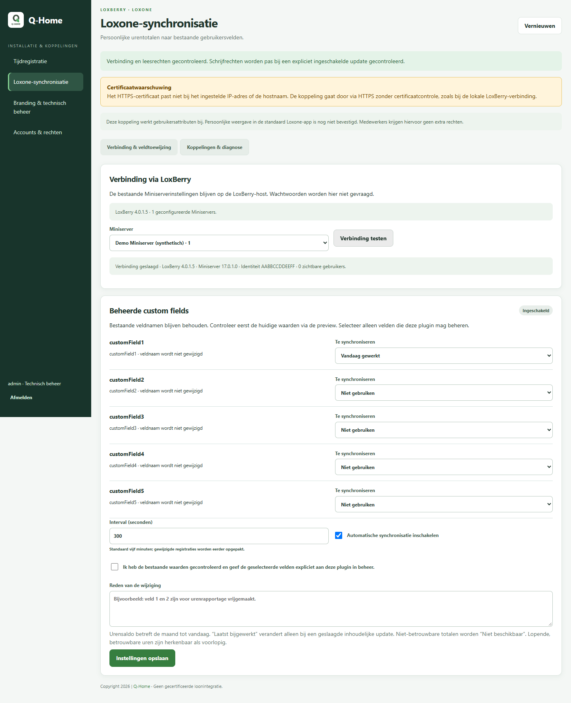

# Versie 1.2.4 — lokaal IP-adres en certificaatwaarschuwingen

De Miniserver mag in LoxBerry met zijn lokale IP-adres geconfigureerd blijven. Qtime gebruikt dezelfde opgeslagen host, HTTPS-poort en aanmeldgegevens. Er hoeft geen tweede account of wachtwoord ingesteld te worden.

De adapter probeert eerst HTTPS met certificaat- en hostnaamcontrole. Alleen als de TLS-handshake aantoonbaar faalt door een niet-passende hostnaam, een niet-vertrouwd certificaat of een verlopen/nog niet geldig certificaat, probeert dezelfde aanvraag opnieuw met de LoxBerry-compatibiliteitsinstellingen: HTTPS zonder certificaatcontrole. Binnen die adapteraanvraag gebruiken de vervolgaanroepen dezelfde modus. Een volgende aanvraag controleert het certificaat opnieuw.

Bijvoorbeeld: het certificaat past niet bij `192.0.2.10`. **Verbinding testen** mag dan slagen en toont daarnaast een gele **Certificaatwaarschuwing**. Ook synchronisatie kan doorgaan. Het verkeer is versleuteld, maar het certificaat bevestigt in deze modus niet de identiteit van de server. De bestaande controle van de Miniserveridentiteit en gebruikers-UUID blijft actief.

De waarschuwing staat apart van succes- en foutmeldingen, blijft na verversen zichtbaar en verschijnt ook wanneer de achtergrondtaak het probleem vaststelt. De laatste controle wordt per LoxBerry-Miniservernummer opgeslagen. Na een geslaagde controle met een geldig certificaat verdwijnt de waarschuwing. Wisselen van selectie toont geen waarschuwing van een andere Miniserver. Een oude hostadapter zonder waarschuwingsmetadata kan een opgeslagen waarschuwing niet stilzwijgend wissen.

Verkeerde aanmeldgegevens, ontbrekende rechten, netwerkuitval, time-outs en ongeldige API-antwoorden blijven fouten. Die aanvragen worden niet wegens een certificaatwaarschuwing herhaald: vooral een onzekere schrijfactie mag niet automatisch nogmaals uitgevoerd worden. Terugval is uitsluitend toegestaan vóór een HTTP-antwoord, bij een herkenbare certificaatfout. Er is geen terugval op onversleuteld HTTP.

De veldmapping, expliciete inschakeling, UUID-koppelingen, firmwarecontrole en controle na een gedeeltelijke gebruikersupdate blijven behouden. Een certificaatwaarschuwing telt op zichzelf niet als een mislukte synchronisatie en brengt geen gebruiker in quarantaine. Echte behoud- en verificatiefouten doen dat wel.

## Installatie en controle

1. Installeer versie 1.2.4 via de pluginbeheerder. De update bevat zowel de hostadapter als de backend en webapp; alleen de backendcontainer herstarten vervangt de code niet.
2. Open **Loxone-synchronisatie**, kies de bestaande Miniserver en klik op **Verbinding testen**.
3. Bij het bekende certificaatprobleem verschijnen een geslaagde verbinding en een gele waarschuwing.
4. Controleer de bestaande koppeling met **Controleren / dry-run** voordat je de eerstvolgende synchronisatie controleert.

Tests gebruiken uitsluitend synthetische SDK-antwoorden en gebruikers. Er is tijdens de ontwikkeling niet verbonden met een productie-Miniserver en er zijn geen productiegebruikers gewijzigd.
