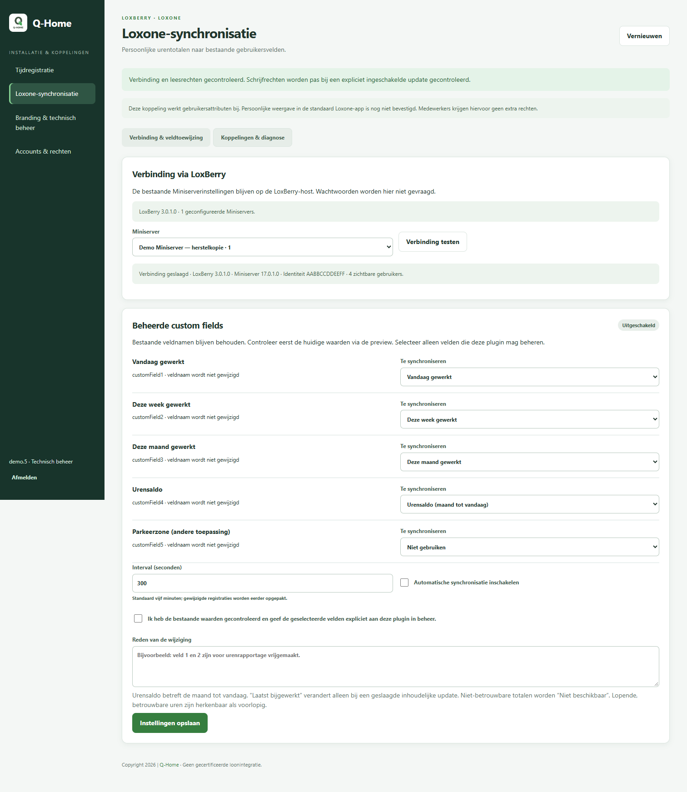
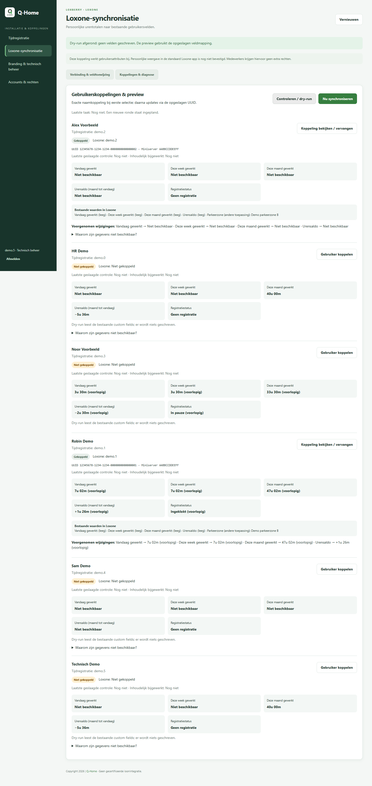

# Persoonlijke urentotalen naar Loxone — 1.2.0

De plugin kan geselecteerde `customField1` t/m `customField5` van bestaande Miniservergebruikers bijwerken. Synchronisatie staat standaard **uit**. De HR-berekening blijft de enige rekenbron. Deze uitbreiding maakt geen functies of gebruikers in Loxone aan.

## Onderzoek, bronnen en ondersteunde configuratie

De repository bevat al een Flask-backend in Docker, de centrale HR-engine, PHP-pagina's op de LoxBerry-host en een LoxBerry-crontab. De plugingegevens noemden alleen een historische minimumversie 1.4.3; zij bevatten geen betrouwbare vaststelling van de momenteel geïnstalleerde LoxBerry- of Miniserverversie. Er is geen productiehost benaderd. De verbindingstest leest de werkelijke versies en identiteit bij ingebruikname.

Geraadpleegd op 9 november 2026:

- [Officiële Loxone API](https://www.loxone.com/enen/kb/api/) en [Usermanagement V17, 31 maart 2026](https://www.loxone.com/enen/wp-content/uploads/sites/3/2026/04/1700_Usermanagement.pdf): gebruikers lezen, via UUID aanpassen en optionele attributen weglaten. Veldnamen zijn uitleesbaar; een ondersteunde setter daarvoor is in dit document niet beschreven. Namen zo nodig eenmalig in **Loxone Config** instellen. Een gebruikersbeheeraccount kan gewone gebruikers beheren; adminaccounts vereisen hogere rechten. Geef medewerkers daarvoor geen gebruikersbeheerrechten.
- [Communicatie met de Miniserver](https://www.loxone.com/wp-content/uploads/datasheets/CommunicatingWithMiniserver.pdf): tokenauthenticatie is de aanbevolen methode; HTTP Basic is een beperkte compatibiliteitsmogelijkheid. Deze adapter hergebruikt de bestaande HTTP-communicatie van LoxBerry over gecontroleerde HTTPS, inclusief diens Basic-authenticatie. Hij implementeert geen eigen tokenbeheer en slaat geen tweede wachtwoord op. Installaties die uitsluitend tokens accepteren zijn hiermee niet ondersteund; verlaag hun beveiliging niet voor deze plugin.
- Officiële LoxBerry-implementatie: [LBSystem](https://github.com/mschlenstedt/Loxberry/blob/master/libs/phplib/loxberry_system.php), [IO-module](https://github.com/mschlenstedt/Loxberry/blob/master/libs/phplib/loxberry_io.php) en [SDK-documentatie](https://wiki.loxberry.de/entwickler/php_develop_plugins_with_php/php_loxberry_sdk_documentation/php_module_loxberry_systemphp/start). De adapter gebruikt `get_miniservers`, `lbversion` en `mshttp_call2`, zodat host, poort, account en CloudDNS uit LoxBerry komen.

**Afgebakende compatibiliteit:** Linux/LoxBerry **3.x of 4.x**, PHP CLI **7.4 of hoger** met cURL en een SDK die `mshttp_call2` bevat; Miniserver **17.x** met de beschreven gebruikers-API en HTTPS. Oudere LoxBerry-SDK's zonder die functie, Gen1 zonder HTTPS, andere firmwarefamilies en token-only communicatie worden geweigerd. De code controleert dit vóór een update. Dit is de geïmplementeerde compatibiliteitsgrens, geen claim van een reeds uitgevoerde hardwaretest. Mocks controleren het V17-contract; een praktijktest op de exacte klantversie blijft verplicht. Verruim de versiegate pas na documentatiecontrole én een geïsoleerde behoudtest.

Configureer in LoxBerry een HTTPS-hostnaam met een certificaat dat de host vertrouwt. De adapter schakelt certificaat- of hostnaamcontrole niet uit, volgt geen redirects en valt niet terug op HTTP. Hergebruik het bestaande passende LoxBerry-account; bewaar geen credentials in deze plugin. De verbindingstest controleert leesrechten. Schrijfrechten worden pas bij een bewust ingeschakelde update getoetst, nooit door een verborgen testwrite.

## Hostadapter en Docker

`bin/host/bridge_daemon.py` draait als `loxberry` onder systemd, met een private Unix-socket `/run/timetracking-loxone/bridge.sock`. Directory en socket zijn respectievelijk 0700/0600. Alleen de hostgebruiker en de huidige root-backendcontainer kunnen erbij. Er is geen TCP-luisterpoort of generieke proxy. Wijzigingen naar een niet-root backend vereisen een bewust ingerichte gedeelde socketgroep; maak de socket niet wereldwijd toegankelijk.

Per aanvraag start een kort PHP-proces dat de actuele LoxBerry-configuratie leest. Daardoor worden gewijzigde host/poort/CloudDNS-instellingen niet in een permanent proces gecachet. De adapter staat uitsluitend inventarisatie, verbindingstest, gebruikerslijst, één gebruiker lezen en een patch met uitsluitend vijf custom-fieldnamen toe. Vrije commando's, URLs, accountcreatie en wachtwoord-/rechtenvelden worden geweigerd. De geselecteerde Miniserver wordt elke keer gecontroleerd aan zijn MAC-identiteit; een hergebruikt configuratieslot mag geen andere Miniserver bereiken.

Alleen `backend` krijgt via `bin/docker-compose.loxone.yml` een read-only mount van de socketdirectory. Er worden geen LoxBerry-configuratiemappen, wachtwoorden, Docker-sockets of andere hostbestanden gemount. De webapp krijgt geen hostmount. De adapter reduceert gebruikersresponsen tot naam, UUID en custom-fieldwaarden. Ruwe gebruikersobjecten met NFC/codes/rechten blijven uitsluitend tijdelijk in het hostproces.

Transportstatus en `LL.Code`/`LL.code` moeten beide succes aangeven. Updates bevatten alleen UUID en gewijzigde geselecteerde velden. Weggelaten velden worden niet opnieuw verzonden. Daarna worden de velden teruggelezen en de overige attributen vergeleken. Bij een onverwachte afwijking stopt deze koppeling in quarantaine: inspecteer de gebruiker en koppel pas na herstel expliciet opnieuw met reden. Er volgt geen automatische volledige gebruikersrollback, die een gelijktijdige toegangsaanpassing zou kunnen overschrijven. Normale externe wijzigingen aan toegang kunnen dus ook een conservatieve controlefout opleveren.

Host- en workerfouten bevatten alleen vaste foutcodes/berichten. Er worden geen URLs met credentials, wachtwoorden, tokens, NFC-tags of onbewerkte API-antwoorden gelogd. PHP-stderr wordt niet doorgestuurd. Diagnostische totalen zijn wel personeelsgegevens en alleen beschikbaar voor `admin` en `technical_admin`; HR en medewerkers krijgen geen toegang tot dit technische scherm.

## Eenmalige inrichting

1. Gebruik eerst een geïsoleerde Qbox/herstelkopie met testgebruikers en een test-Miniserver. Controleer versie, certificaat en de LoxBerry-Miniserverconfiguratie. Maak geen productiekoppelingen tijdens ontwikkeling.
2. Installeer de ZIP van deze branch via de normale lifecycle. `postroot` probeert de private hostservice te installeren/herstarten en voegt de socket-overlay toe aan de bestaande Compose-bestanden. De berekening en het registreren werken ook als de hostadapter niet beschikbaar is. Los de fout dan op vóór inschakelen.
3. Open **Loxone-synchronisatie** via technisch beheer. Kies een geconfigureerde Miniserver en test de verbinding. De test toont versies, identiteit, bestaande veldnamen en het aantal zichtbare gebruikers.
4. Sla de selectie eerst **uitgeschakeld** op. Behoud velden die al voor andere toepassingen gebruikt worden op **Niet gebruiken**. Verander veldnamen indien gewenst handmatig in Loxone Config; de plugin doet dat niet.
5. Koppel de relevante medewerkers: standaard exact en hoofdlettergevoelig op tijdregistratiegebruikersnaam, optioneel een andere Loxone-naam, of een handmatig gekozen bestaande UUID. Geen fuzzy matching. Dubbele matches en dubbele UUID-koppelingen worden geblokkeerd. Niet-opgeloste historische HR-identiteiten worden niet automatisch naar Loxone geschreven.
6. Open **Controleren / dry-run**. Bekijk per medewerker de huidige waarden én de voorgenomen wijzigingen. Dry-run schrijft niets; instellingen en koppelingen worden wel expliciet opgeslagen als je hun eigen opslaanknop gebruikt. De preview gebruikt de opgeslagen mapping.
7. Kies de gewenste mapping, bevestig expliciet het beheer van die velden, geef een reden en schakel synchronisatie in. Standaardinterval: 300 seconden; instelbaar 60–3600 seconden. **Nu synchroniseren** plant een taak in, normaal binnen één minuut.
8. Vergelijk de eerste echte testupdate met de bron en verifieer dat groepen, rechten, NFC-tags, toegangscodes, geldigheidsperiodes en niet-beheerde custom fields intact blijven. Test ook ontbrekende rechten en verbindingen. Bevestig dit op de gebruikte firmware vóór productie.

Een hernoemde gebruiker behoudt zijn UUID; diagnose toont de actuele naam. Een verwijderde UUID wordt nooit automatisch aan een nieuw account met dezelfde naam gekoppeld. Bewuste her-koppeling vereist selectie en reden. Een andere Miniserverselectie verwijdert de actieve koppelingen uit de configuratie; de eerdere instelling blijft in de audit. Op de oude Miniserver worden geen velden gewist.

## Berekening en waarden

- Dag, week (maandag) en maand volgen de centrale bedrijfstijdzone. Werkelijke pauzes en ingestelde automatische aftrek worden door de HR-engine verwerkt, zonder tweede berekening.
- Betrouwbare lopende sessies tellen mee en krijgen de tekst **(voorlopig)**. Een te lange sessie, ontbrekende stop uit een vorige dag, onlogische volgorde, nog niet gecontroleerde systeemstop of ontbrekende bron maakt het betrokken totaal **Niet beschikbaar**. De diagnose geeft de oorzaken. Een geldige nul op een verwachte vrije dag kan wel worden verstuurd.
- **Urensaldo** is de maand vanaf dag één tot en met vandaag. Zonder geldig rooster over deze hele periode of bij onbetrouwbare registraties wordt geen nul verzonnen. Een rooster dat pas later in de maand ingaat kan dus terecht nog geen volledig maandensaldo leveren.
- Tijden zijn tekst, bijvoorbeeld `7u 15m`, `+2u 15m` en een lokale bijwerkdatum. Dit zijn geen gecertificeerde loonvelden.
- De bijwerkdatum beweegt alleen mee als een ander beheerd veld inhoudelijk verandert. Hij veroorzaakt geen eigen periodieke writes. Alleen een bijwerkdatum kiezen is daarom niet voldoende om in te schakelen. Diagnose onderscheidt laatste geslaagde controle en laatste inhoudelijke update.
- Het tijdregistratieaccount moet bestaan en niet geblokkeerd/gearchiveerd zijn. Er worden geen verwijderde medewerkers of onopgeloste historische pseudo-identiteiten gesynchroniseerd.

## Planning, fouten en herstel

De bestaande LoxBerry-cron start één uitvoerder per minuut via `flock`; in Gunicorn draait geen scheduler. Een MongoDB-lease voorkomt overlappende uitvoerders en conflicterende configuratiebewerkingen. Registraties, correcties en regels maken een kleine notificatie; kort opeenvolgende wijzigingen worden samengenomen. Zonder wijzigingen wordt volgens het ingestelde interval gecontroleerd, zodat dag-, week-, maand- en jaarwisselingen vanzelf volgen. Eventgestuurde updates hebben door cron een resolutie van ongeveer één minuut, niet onmiddellijk per scan.

De worker leest altijd de actuele bron en de huidige custom fields. Alleen werkelijke verschillen in geselecteerde velden worden geschreven. Een notificatiefout heeft geen invloed op de registratie; de periodieke sweep herstelt die. Fouten krijgen een begrensde back-off (vanaf 60 seconden, maximaal één uur), uitgevoerd bij een volgende geschikte cronronde. Handmatig inplannen vraagt bewust een nieuwe poging. Herstel verstuurt de actuele totalen, geen opgeslagen oude payloads. Verloren succesantwoorden kunnen via teruglezen worden bevestigd. Quarantaine na een behoud-/terugleesfout vereist handmatig onderzoek en her-koppeling.

Bewaar de databasecollecties `loxone_sync_config`, `loxone_sync_status`, `loxone_sync_meta` en `loxone_sync_audit` in de normale MongoDB-back-up. Ze wijzigen geen oorspronkelijke registraties. De audit bevat configuratie en koppelingen; geen wachtwoorden. Er is nog geen bewaartermijn/archiefinterface voor deze nieuwe audit.

## API en diagnose

Onder `/api/v1/loxone-sync`: `config`, `miniservers`, `test`, `users`, `links`, `diagnostics`, `preview` en `run`. Alle endpoints vereisen de actuele technische beheerdersrol uit de database, ook bij rechtstreeks aanroepen. Configuratie/koppeling gebruiken een revisiecontrole en reden; de interface verzorgt die. `run` geeft 202 en voert geen netwerkupdate uit in het webverzoek. Geen van deze endpoints accepteert een willekeurig Miniservercommando.

Screenshots en browsercontrole gebruiken uitsluitend synthetische accounts en een in-memory Miniserverimitatie. Er zijn geen productiegebruikers bijgewerkt.

## Upgrade en beperkingen

- Versie 1.2.0 bouwt voort op de HR-uitbreiding 1.1.0. Lokale `.env`, Compose/override, branding, databasevolumes en bestaande registraties blijven behouden via de bestaande lifecycle. De nieuwe overlay wordt afzonderlijk gecombineerd; de lokale Compose wordt niet vervangen door een nieuw standaardbestand. Nieuwe synchronisatie staat uit.
- De root-lifecycle installeert `timetracking-loxone.service`; PHP CLI/cURL en SDK moeten op de host beschikbaar zijn. Bij een ontbrekende service: controleer `systemctl status timetracking-loxone.service` en de verbindingstest. Na handmatige herstart van containers de overlay blijven meegeven: `docker compose -f docker-compose.yml -f docker-compose.loxone.yml up -d --no-deps backend` (voeg een bestaande lokale override ook toe).
- De socketdirectory blijft bij serviceherstart behouden, zodat een bestaande container-bindmount geldig blijft. Alleen de socket wordt opnieuw aangemaakt. Uninstall schakelt de service uit. De bestaande productarchitectuur gebruikt vaste container- en servicenamen en ondersteunt hiermee één installatie per host.
- Test de echte ZIP-upgrade, cron, SDK-authenticatie, TLS en gedeeltelijke update op een geïsoleerde Qbox. Mocks bewijzen geen hardwarecompatibiliteit. Er wordt met deze PR niet automatisch uitgerold.
- Kleine installaties: totalen lezen de bestaande HR-bronnen volledig. Er is geen prestatietest voor grote aantallen medewerkers. Preview kan bij veel gebruikers traag zijn; netwerkuitval kan per gebruiker tot de begrensde adaptertime-out kosten.
- Dit is geen continue live stream. Gekoppelde velden moeten exclusief voor deze plugin worden gekozen: een andere schrijver naar hetzelfde veld zal bij de volgende ronde worden overschreven. Een gelijktijdige externe toegangswijziging kan een behoudcontrole terecht laten stoppen.
- **Persoonlijke appweergave: niet bevestigd.** Er is geen test uitgevoerd die bewijst dat een gewone medewerker deze velden zelf in de standaard Loxone-app ziet of dat anderen ze niet kunnen zien. Er worden geen extra rechten aan medewerkers verleend. Leg de uitkomst van een afzonderlijke praktijktest met normale medewerker- en beheeraccounts apart vast; behandel de waarden als personeelsgegevens.

Voor rollback: synchronisatie eerst uitschakelen, service/cron stoppen en de bijbehorende code/databaseback-up herstellen. Er wordt op rollback niet naar Miniservergebruikers geschreven om eerdere custom-fieldwaarden te reconstrueren; controleer die apart op de test-Miniserver.
