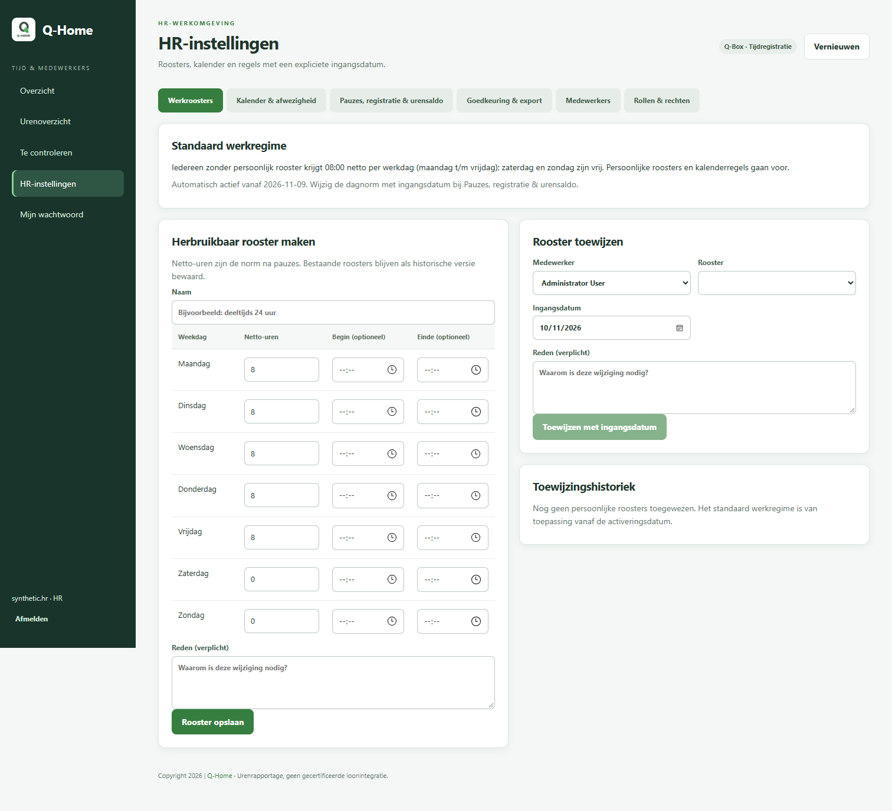
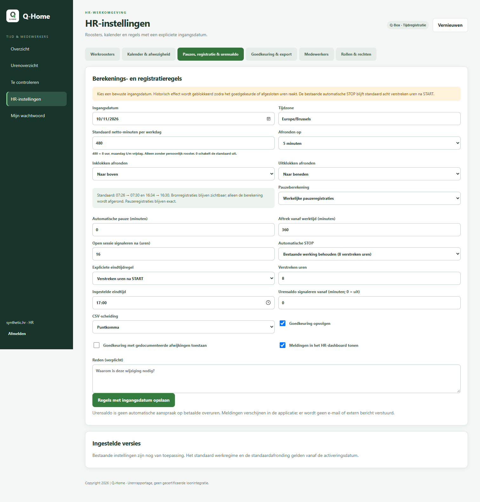
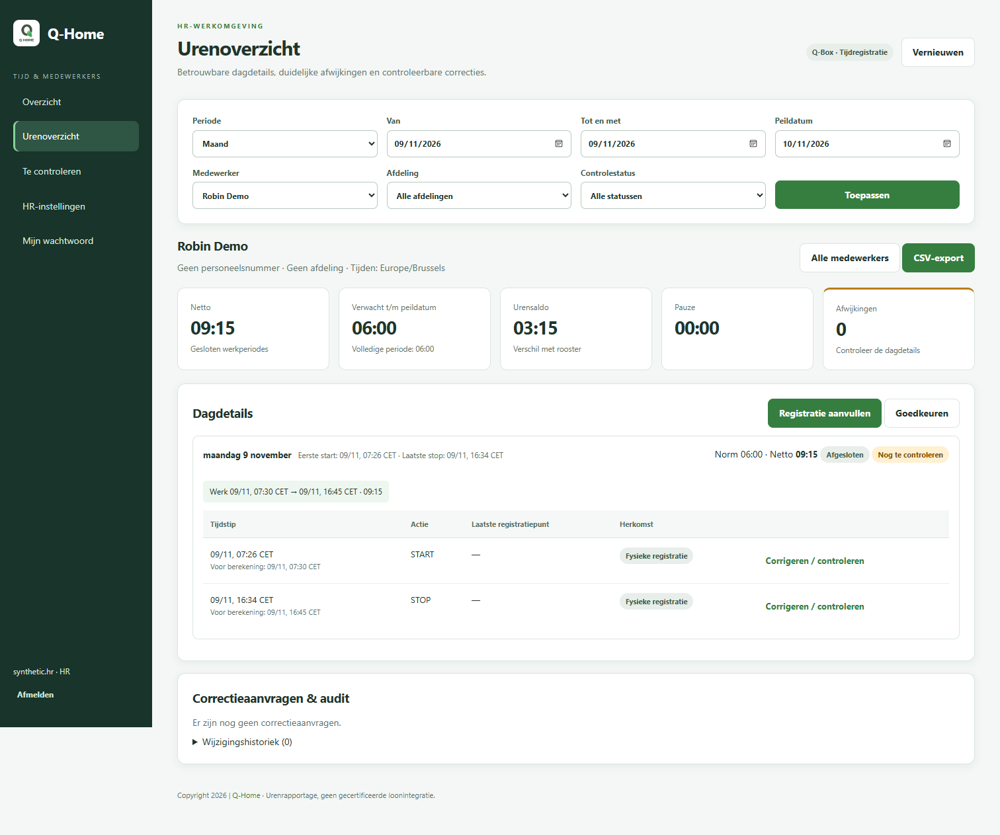

# Versie 1.2.3 — afronding en standaard werkregime

## Standaard na de update

Iedereen zonder toegewezen persoonlijk rooster krijgt **8 netto-uren per werkdag**, maandag tot en met vrijdag: 40 uur per week. Zaterdag en zondag hebben een norm van nul. Een persoonlijk rooster blijft leidend, ook als daarin een werkdag nul uur heeft. Feestdagen, bedrijfssluitingen en individuele afwezigheden kunnen de norm via de kalender aanpassen.

De instelling maakt geen fictieve START/STOP-registraties of gewerkte uren aan. Acht uur is de verwachte netto-werktijd na pauzes. De bestaande automatische afsluitregel blijft een afzonderlijke instelling en wordt niet gewijzigd.

## Afronding instellen

Ga naar **HR-instellingen → Pauzes, registratie & urensaldo**.

1. Kies de **ingangsdatum**.
2. Kies **Afronden op**: uit, 1, 5, 10, 15, 30 of 60 minuten.
3. Kies afzonderlijk voor **Inklokken afronden** en **Uitklokken afronden**: naar boven, naar beneden of dichtstbijzijnde. Bij precies halverwege gaat dichtstbijzijnde naar boven.
4. Geef een reden en klik op **Regels met ingangsdatum opslaan**.

De nieuwe standaard is **5 minuten**, **inklokken naar boven**, **uitklokken naar beneden**. Daardoor telt 07:26 als 07:30 en 16:34 als 16:30. Dit levert negen uur vóór pauzeaftrek op; bij een pauze van dertig minuten is dat 8 uur 30 netto.

Op hetzelfde formulier staat **Standaard netto-minuten per werkdag**. `480` betekent acht uur; `360` betekent zes uur. `0` schakelt de standaard uit, waarna personen zonder persoonlijk rooster geen norm hebben. Voor afwijkende werkdagen of deeltijdse medewerkers wijs je een persoonlijk rooster toe bij **Werkroosters**.

## Welke tijden blijven zichtbaar?

De bronregistraties blijven ongewijzigd. Dagdetails tonen de werkelijke kloktijd en bij START/STOP ook **Voor berekening**. De werkperiodes en totalen gebruiken de afronding. CSV-export, het urenoverzicht en Loxone-totalen gebruiken dezelfde berekening.

Alleen de buitenste START/STOP-grenzen van elke werksessie worden afgerond. BREAK/RETURN blijven exact; er wordt geen vijfminutenafronding op iedere pauze toegepast. Een automatische pauzeaftrek komt na de afronding en wordt niet boven op een geregistreerde pauze afgetrokken. Dit geldt ook voor handmatige correcties en systeemstops; hun herkomst blijft herkenbaar.

Een zeer korte sessie die door afronding geen werktijd overhoudt telt als nul, nooit negatief. Als naar buiten afgeronde sessies elkaar overlappen, wordt overlappende tijd slechts eenmaal gerekend; de volgende sessie begint voor de berekening ten vroegste aan het berekende einde van de vorige. Daardoor kunnen de nominale afgeronde klokgrenzen afwijken van de werkelijk gebruikte werkperiodes. Bij een open sessie wordt de start afgerond, maar de actuele tijd niet naar een toekomstige eindgrens afgerond. Nachtdiensten worden per lokale kalenderdag verdeeld; zomer- en wintertijd gebruiken werkelijk verstreken tijd.

Onderstaand testvoorbeeld gebruikt bewust gewijzigde instellingen: een norm van zes uur en een stap van vijftien minuten, met uitklokken naar boven. De standaard blijft acht uur en vijf minuten met uitklokken naar beneden.

## Bestaande uren en upgrade

Bij de eerste backendstart na de update wordt één activeringsdatum opgeslagen, met auditregel: de lokale datum van die start, of later als er reeds een goedgekeurde/afgesloten periode doorloopt. De datum schuift bij herstart niet op. Er wordt geen lijst medewerkers of historische bronregistraties herschreven. De nieuwe standaard geldt ook voor medewerkers die later automatisch via Loxone worden aangemaakt.

Vóór die datum blijven de oude norm en de werkelijke tijden gelden, tenzij HR expliciet een gedateerde regel met de nieuwe opties opslaat. Wijzigingen met terugwerkende kracht die goedgekeurde of afgesloten uren raken worden geblokkeerd. Trek eerst de goedkeuring in of heropen de periode met reden. De activeringsdatum is zichtbaar bij **Werkroosters**; latere instellingen hebben hun eigen ingangsdatum.

Maak vóór installatie de gebruikelijke herstelbare back-up en controleer de update eerst op een geïsoleerde Qbox. De lokale en CI-tests gebruiken synthetische gegevens; er is geen productie-Qbox of Miniserver gewijzigd.
